# Lagrange Reader

<div align="center">


# Lagrange Reader

An offline-first Android reader for BookOrbit, Komga, and Kavita.

[](LICENSE)
[](https://github.com/van-geaux/lagrange-reader/releases/tag/v2.1.0)
[](https://github.com/van-geaux/lagrange-reader/actions/workflows/android-debug.yml)
[](https://github.com/van-geaux/lagrange-reader/releases)

</div>

Lagrange Reader is an independent Android app for reading and listening to books hosted on [BookOrbit](https://github.com/BookOrbit), [Komga](https://komga.org/), and [Kavita](https://www.kavitareader.com/). It began with a personal need: I wanted an app that lets me take my library with me and read offline.

It is now for anyone who already uses a BookOrbit, Komga, or Kavita server, whether they run it themselves or received an account from someone else, and wants a native Android experience for their library.

Your configured server remains the source of truth for its library. Lagrange is the Android client: it lets you browse, download, read, listen where supported, and keep working when your connection is unavailable. When you reconnect, queued progress and other supported changes synchronize back to the active provider.

This is a community project, not an official BookOrbit application. Development was AI-assisted, with the implementation, testing, and product decisions reviewed by the project owner.

## Contributing

Contributions are welcome. Start with an issue or feature discussion, then follow the repository workflow in [`CONTRIBUTING.md`](CONTRIBUTING.md) before opening a pull request. Security reports should follow [`SECURITY.md`](SECURITY.md).

## Screenshots

The following screenshots show the main reading and library experience. More screenshots are available below.


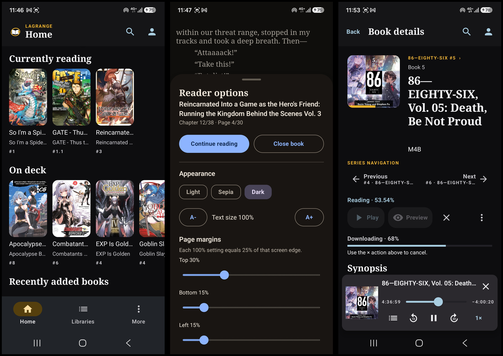
<!-- <p align="center">
  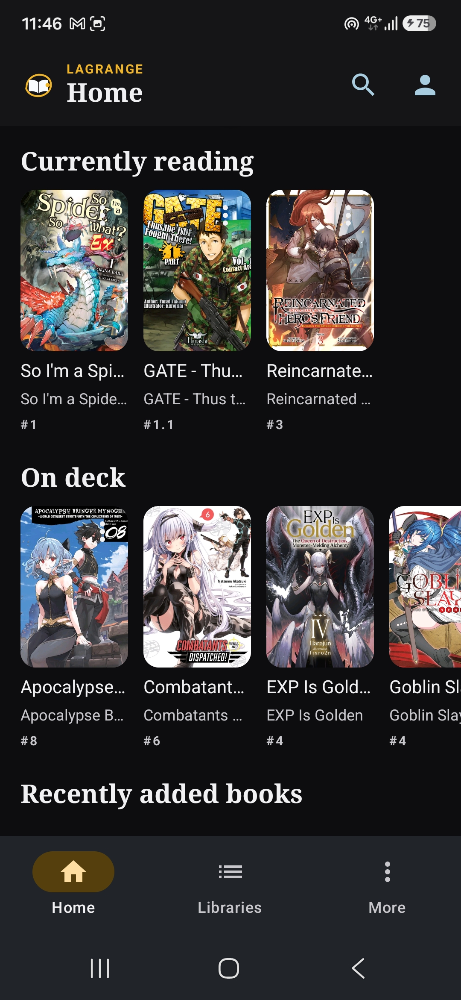
  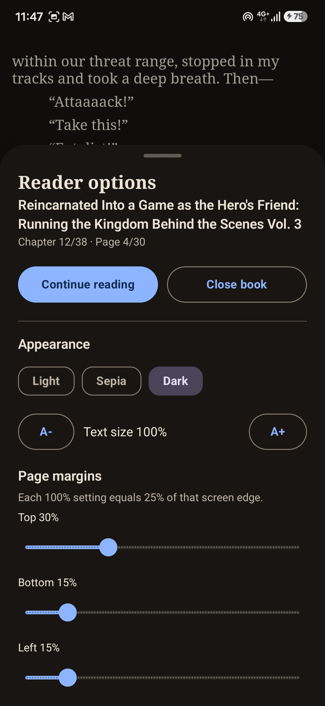
  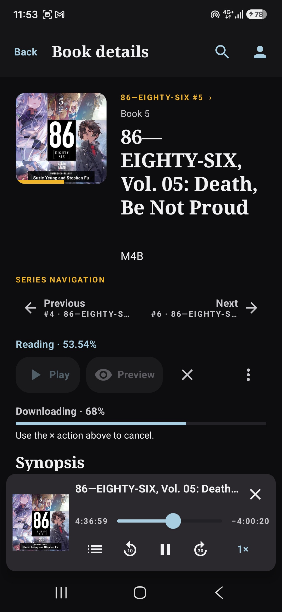
</p> -->

<details>
<summary>More screenshots</summary>

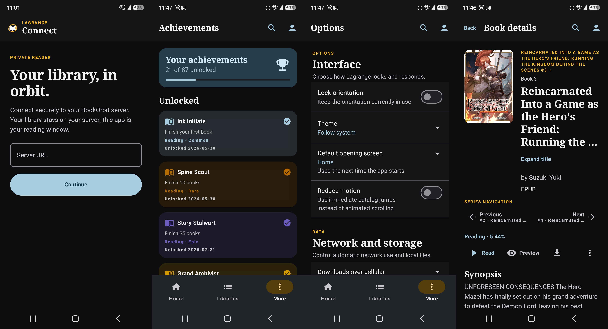
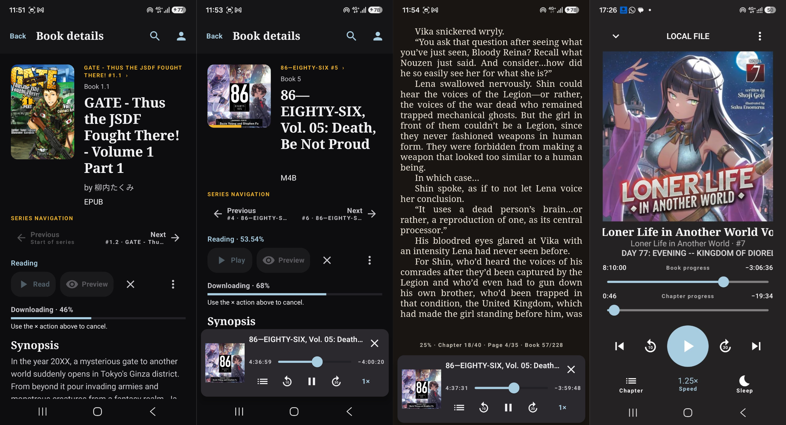
<!-- <p align="center">
  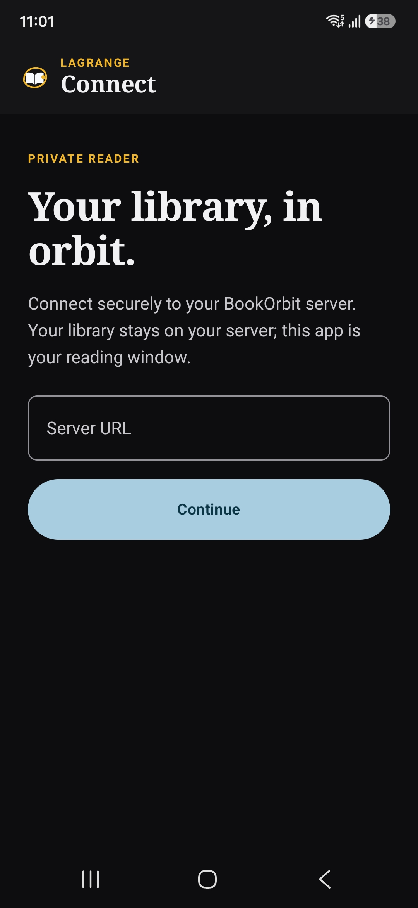
  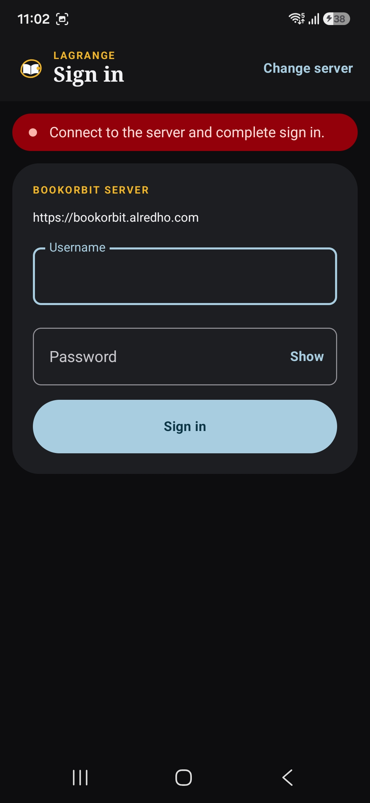
  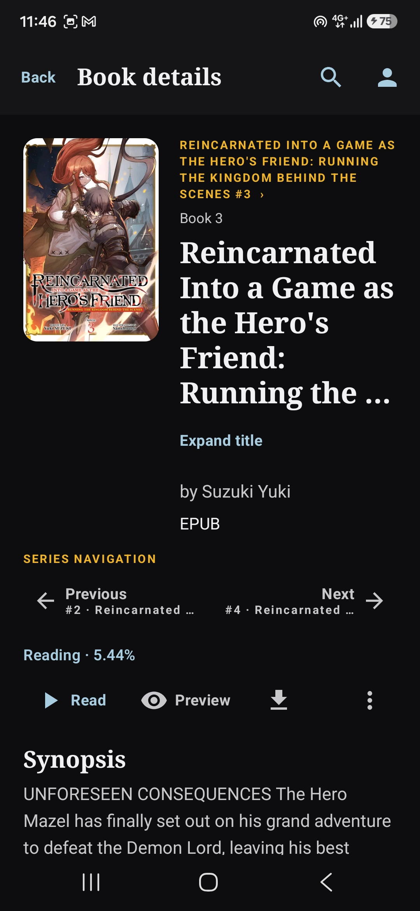
  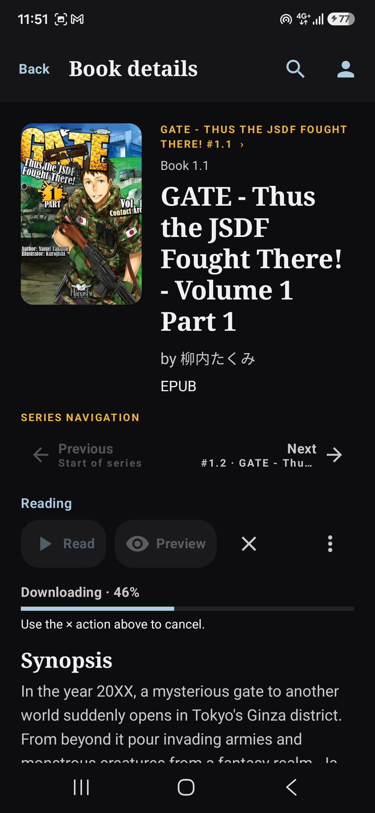
</p>

<p align="center">
  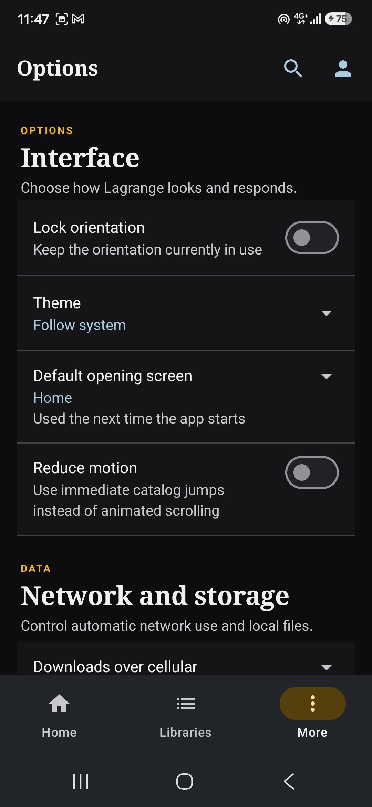
  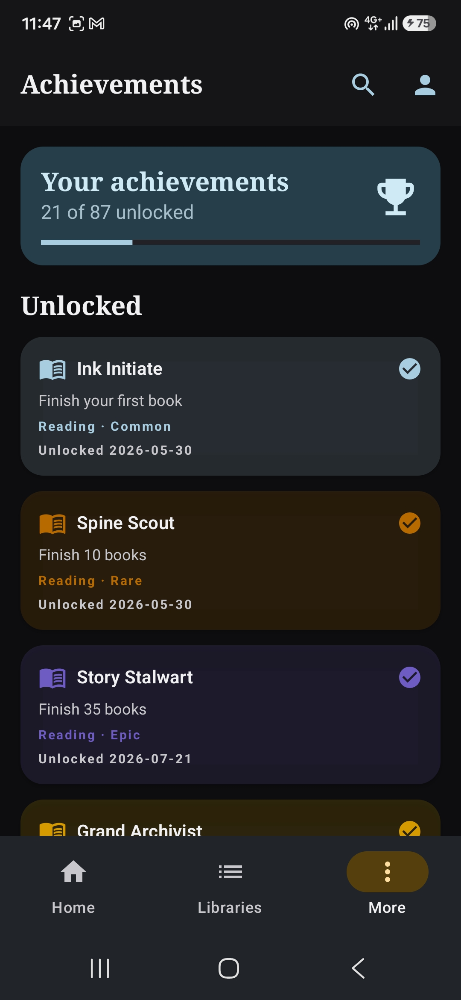
  
  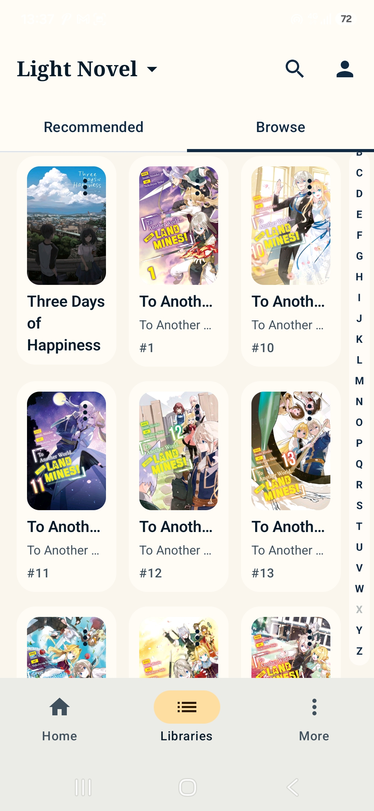
</p> -->

</details>

## Who this is for

Use Lagrange if you have:

- access to a BookOrbit, Komga, or Kavita server and an account on that server;
- an Android phone or tablet running Android 8.0 (API 26) or newer;
- books, comics, PDFs, or audiobooks that you want available away from the server.

Lagrange is not a standalone ebook reader and does not provide a BookOrbit, Komga, or Kavita server. If you do not already have server access, start with the [BookOrbit project](https://github.com/BookOrbit), [Komga](https://komga.org/), or [Kavita](https://www.kavitareader.com/).

## Get started

1. Install the latest [Lagrange release](https://github.com/van-geaux/lagrange-reader/releases).
2. Open the app and choose BookOrbit, Komga, or Kavita, then enter your server URL. Prefer HTTPS, especially outside your home network.
3. Sign in with the account provided by your server administrator.
4. Browse your libraries, open a book, or download content from Book Detail for offline use.

The current sign-in flow supports BookOrbit username/password and server-hosted OIDC sign-in in a WebView, Komga Basic Auth and server-hosted OAuth2/OIDC sign-in in a WebView, and Kavita username/password plus server-hosted OIDC sign-in in a WebView. Native OIDC/AppAuth is not implemented. See [BookOrbit OIDC / SSO Authentication](docs/providers/bookorbit/oidc-authentication.md), [Komga integration](docs/providers/komga/integration.md), and [Kavita integration](docs/providers/kavita/integration.md).

## How the client works

Lagrange is a standalone native Android client, not a wrapper around any provider's web interface. It has its own Compose browsing experience, Room-backed local catalog and caches, durable offline downloads, background synchronization, Readium-based publication readers, and persistent Media3 audiobook playback. The configured provider supplies authenticated server and library data; Lagrange owns the Android interface, local state, reading, listening, and offline behavior.

The important boundary is simple: the configured provider stays authoritative, while Lagrange maintains useful local state so reading and listening can continue through unreliable connectivity. This also means Lagrange does not attempt to replace any provider's administration, integrations, or web interface.

## Features

- **Offline-first library:** browse cached books and reopen downloaded EPUB, PDF, CBZ, and supported audiobook files without a connection.
- **Two-way sync:** send supported local reading/listening progress to the configured provider, receive supported server-side progress and status changes, and replay queued offline progress after reconnecting.
- **EPUB reading:** paginated chapters, themes, text size, independent margins, chapter/page navigation, exact resume, keep-awake mode, per-library font selection through grouped normal/accessibility menus, one imported custom `.ttf`/`.otf` font, read-along narration for local EPUB 3 media overlays, and service-owned Android text to speech with sentence highlighting, preset or custom 0.5×–2× speed and pitch, optional speed-scaled punctuation pauses, uninterrupted rotation/screen-lock playback, media controls, background progress persistence, and separate **Listen from here**/**Keep listening** actions.
- **PDF and comic reading:** Readium-powered PDF and image readers with fullscreen controls, page navigation, Preview isolation, and CBZ/online CBR support.
- **Audiobook playback:** compact and full players with seeking, chapter selection, previous/next chapter controls, playback speed, sleep timer, resume, responsive portrait/landscape layouts, session history, read-along support, and optional pausing/resuming when Android reports competing audio focus (enabled by default).
- **Library discovery:** Home, libraries, series, authors, search, achievements, local books, filters, sorting, and series navigation.
- **Reliable offline downloads:** progress, cancellation, retry/update flows, cache validation, and safe local replacement.
- **Personalized controls:** five app themes, reader themes, orientation lock, reduce motion, cellular download policy, cache management, and background-network controls.

## Supported formats

| Format | Online | Offline | Notes |
| --- | :---: | :---: | --- |
| EPUB / KEPUB | Yes | Yes | Full paginated reader with themes, margins, chapters, resume, publisher narration, and foreground-service Android text to speech that continues through rotation and screen lock. |
| PDF | Yes | Yes | Readium PDF reader with page navigation and resume. |
| CBZ | Yes | Yes | Image-based comic reader. |
| CBR / CB7 | Yes | Yes | Online page extraction is supported; offline reading uses client-side RAR4/RAR5/7z extraction into a cached CBZ. User-confirmed offline opening works. |
| Audiobooks supported by BookOrbit | Yes | Yes | Readium audio playback with chapters, speed control, seeking, and resume. |

The following ebook formats are intentionally not supported at this time: MOBI, AZW, AZW3, and FB2. Conversion may be considered later. Audiobook and unusual comic files still benefit from broader device testing.

## Supported providers

Lagrange currently supports BookOrbit, Komga, and Kavita. Each provider has different capabilities, authentication methods, and offline behavior. See the provider documentation for details:

- [BookOrbit](docs/providers/bookorbit/)
- [Komga](docs/providers/komga/)
- [Kavita](docs/providers/kavita/)

Provider-specific validation is tracked in the [provider function matrix](docs/provider-checklists/module-function-matrix.md).

## Sync accuracy by format

| Format | What syncs | Accuracy notes |
| --- | --- | --- |
| EPUB / KEPUB | Overall `percentage`, plus a one-based chapter/page fallback | Server `percentage` is generally an accurate overall-progress signal, but the exact in-chapter/on-screen location is approximate since exact Readium `Locator`/CFI is not uploaded. Same-device resume from the local Readium `Locator` is usually exact. |
| PDF | Page-index progress | Synchronizes the current page index; subject to queue/throttle and network delay, so it does not guarantee pixel- or viewport-exact cross-device resume. |
| CBZ | Page-index progress | Same page-index synchronization and delay characteristics as PDF. |
| CBR / CB7 | Page-index progress | Same page-index synchronization and delay characteristics as PDF; offline reading uses client-side extraction into a cached CBZ. |
| Audiobooks | Periodic position/percentage snapshots | Position is sampled locally and queued/throttled before upload, so server-side progress reflects a periodic snapshot rather than an exact wall-clock playback timestamp. |
| Unsupported formats (MOBI, AZW, AZW3, FB2) | Nothing | No reader or progress sync is available for these formats. |

Progress uploads are queued and throttled rather than sent immediately, and can be delayed by connectivity; a clean reader/player close attempts a best-effort flush of the pending queue but is not guaranteed to complete before the app fully closes offline.

## Server reading sessions

Lagrange separately records active reading/listening intervals through BookOrbit's file-scoped `POST /api/v1/books/files/{fileId}/sessions` endpoint. Sessions are authenticated, stored in a durable offline queue, retried in the background, and deduplicated with a stable session ID. The server source is `web`, which BookOrbit reports in its native `BookOrbit` source bucket.

| Format | Session starts | Pause/close behavior | Progress and timing |
| --- | --- | --- | --- |
| EPUB / KEPUB | When usable publication content opens | Ordinary backgrounding pauses the interval unless foreground TTS is actively reading; pausing TTS or closing the reader finalizes it | Percentage/chapter fallback; visible reading plus active foreground-service TTS time |
| PDF | When usable pages open | Same pause/resume and close behavior as EPUB | Page-based percentage; active foreground time only |
| CBZ / CBR / CB7 | When usable comic pages open | Same pause/resume and close behavior as EPUB | Page-based percentage; CBR/CB7 may be normalized to a cached CBZ locally, while the original BookOrbit file ID is retained |
| Audiobooks | When actual playback begins | Tapping pause finalizes the active listening interval; play starts a new interval; player close also finalizes it | Wall-clock active listening duration and periodic position/percentage; playback speed does not multiply session duration |

Preview sessions are excluded. Sessions shorter than 10 seconds are discarded by the client. Paused, background, and idle time is not counted. Server sessions support analytics and reading history; exact local audiobook seeking remains backed by Lagrange's local session history.

## Privacy, telemetry, and data

Lagrange does not include behavioral telemetry, advertising tracking, an analytics SDK, or a remote crash-reporting service. It does not collect usage events or device identifiers for the Lagrange project.

The app does send functional requests to the provider server that you configure. Depending on the provider and features you use, this includes authentication, library and book metadata, cover and media requests, reading/listening progress, reading-status changes, personal ratings, Statistics requests, and server reading-history requests. These requests are required for the app to browse, synchronize, read, listen, and recover progress.

Lagrange stores app data locally in its private Android sandbox, including session cookies, cached catalog data, downloaded files, reader state, queued progress, preferences, and exact local audiobook session history. Exact local audiobook session-history events are not uploaded by Lagrange; a server-history view only reads analytics records already stored by providers that expose that capability.

The configured provider may retain or log normal server-side request information such as account activity, request timestamps, and network metadata. That server-side retention is controlled by the provider and its administrator, not by Lagrange. Use HTTPS for the configured server; cleartext HTTP can expose credentials, session tokens, metadata, progress, and content on the network. See [`docs/privacy.md`](docs/privacy.md) for more details.

## Android permissions

Lagrange requests only the permissions needed for networking, media playback, and playback notifications:

| Permission | Why it is requested |
| --- | --- |
| `INTERNET` | Connect to the configured provider server for authentication, catalog data, content, synchronization, and media playback. |
| `ACCESS_NETWORK_STATE` | Detect whether a network is available and apply the app's online/offline and background-network behavior. |
| `FOREGROUND_SERVICE` | Keep audiobook playback running in a foreground service when the app is backgrounded. |
| `FOREGROUND_SERVICE_MEDIA_PLAYBACK` | Declare that the foreground service is used for media playback under current Android rules. |
| `POST_NOTIFICATIONS` | Show audiobook playback controls and other user-visible notifications on Android versions that require notification permission. |

The app does not request location, contacts, camera, microphone, phone, SMS, storage-wide, or advertising-ID permissions.

## Roadmap

Remaining follow-up work includes but is not limited to:

- Support for additional book formats; MOBI, AZW, AZW3, and FB2 remain unsupported.
- Implemented the explicit BookOrbit OIDC WebView flow and retained the generic Open server sign-in fallback. Real-provider/device validation remains required; native AppAuth is separate follow-up work.
- Broader bulk actions for Local books beyond the implemented multi-select `Delete local` flow.

More details are in the [Roadmap](docs/roadmap.md)

## Building manually

### Requirements

- Windows, macOS, or Linux with a current Android Studio installation.
- JDK 17.
- Android SDK with API 35 installed.
- An Android device or emulator running API 26 or newer for manual testing.

Clone the repository, open it in Android Studio, and let it use the included Gradle wrapper. From a terminal at the repository root, the release build is:

```text
# macOS/Linux
./gradlew assembleRelease

# Windows PowerShell
.\gradlew.bat assembleRelease
```

The generated APK is:

```text
app/build/outputs/apk/release/app-release.apk
```

For local builds, the signed APK is generated under `app/build/outputs/apk/release/`. Distributed APKs are published as GitHub Release assets. Starting with 1.5.2, releases provide `Lagrange-<version>.apk` as the normal combined download, plus `Lagrange-<version>-x86.apk`, `Lagrange-<version>-x86_64.apk`, and `Lagrange-<version>-arm.apk` for manual ABI selection. If you are unsure which ABI to use, download the plain `Lagrange-<version>.apk` file. Keep `release-key.jks` and `keystore.properties` backed up securely; they are intentionally ignored by Git.

Useful verification commands are:

```text
# macOS/Linux
./gradlew testDebugUnitTest lintDebug assembleDebug assembleDebugAndroidTest

# Windows PowerShell
.\gradlew.bat testDebugUnitTest lintDebug assembleDebug assembleDebugAndroidTest
```

Debug APKs are built for 64-bit ARM devices only (`arm64-v8a`); use the timestamped debug APK produced by `assembleDebug` for device handoff testing.

For machine setup details and the manual test matrix, see [`docs/setup.md`](docs/setup.md) and [`docs/testing.md`](docs/testing.md).

## Design inspiration and attributions

Lagrange Reader's interface and interaction ideas were informed by the clarity and workflows of [Plex](https://www.plex.tv/), [Komga](https://komga.org/), [Audiobookshelf](https://www.audiobookshelf.org/), and [Suwayomi](https://suwayomi.org/). These projects are inspirations only; Lagrange Reader is independently developed and is not affiliated with, endorsed by, or sponsored by them.

## License and acknowledgements

Lagrange Reader is licensed under the [GNU General Public License, version 3](LICENSE). A Google Play release is planned.

Third-party libraries and embedded assets remain under their respective licenses. See [`THIRD_PARTY_NOTICES.md`](THIRD_PARTY_NOTICES.md) for the dependency and attribution inventory. See [`docs/privacy.md`](docs/privacy.md) for the app's local-data and network behavior.

Thank you to the BookOrbit maintainers and contributors for the server and library experience that inspired this app, to the Readium Foundation and open-source library authors whose work makes the reader possible, and to everyone who tests Lagrange and reports issues.
